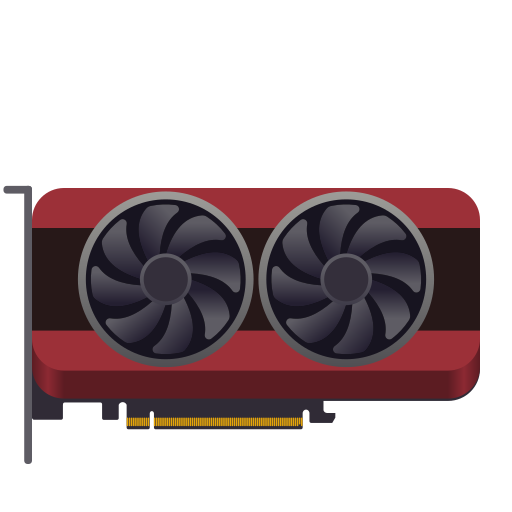
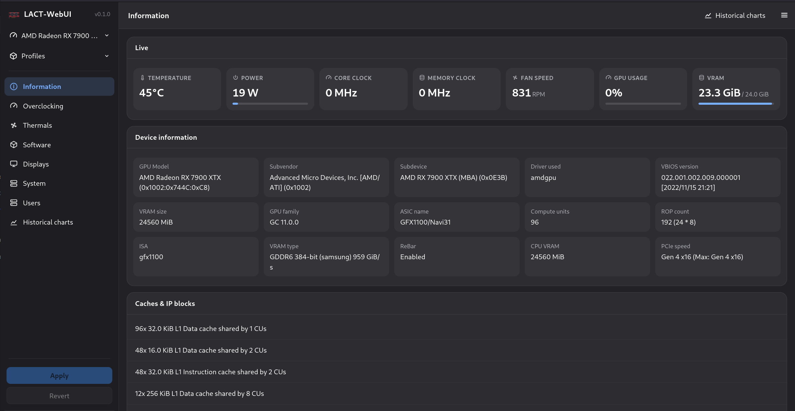
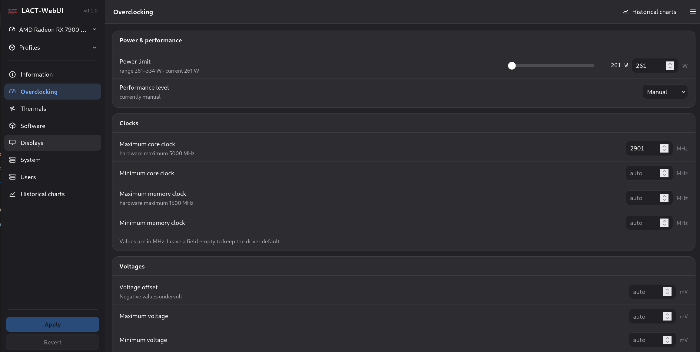
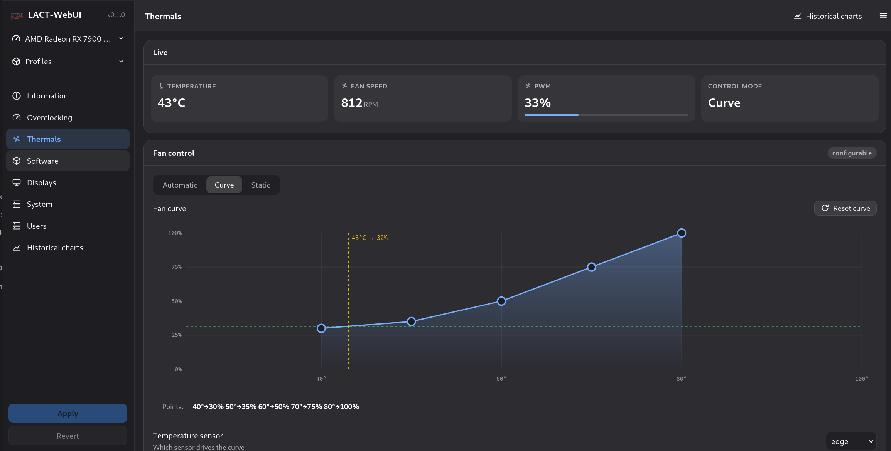
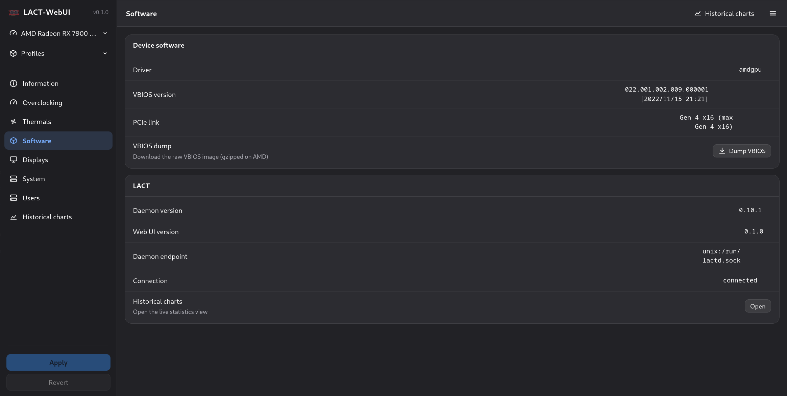
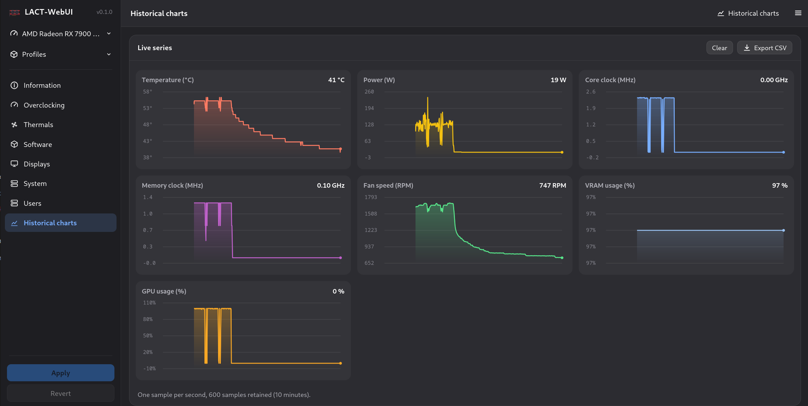

# LACT WebUI — Linux GPU Control Application, headless

> **This is a fork of [LACT](https://github.com/ilya-zlobintsev/LACT) with the GTK4 desktop UI
> replaced by a browser UI.** The `lact-gui` crate is gone; a new `lact-webui` crate serves the same
> functionality over HTTP so a headless machine can be controlled from any browser on the network.
> The daemon, the CLI, the config format and all GPU support are unchanged.
>
> ```sh
> sudo ./scripts/install.sh              # builds, installs, asks for the first admin password
> # or manually:
> sudo lact-webui --add-user admin --role admin
> sudo systemctl enable --now lactd lact-webui
> # open http://<host>:12800
> ```
>
> Accounts have two roles: **admin** (full control) and **operator** (monitoring only, every write
> is rejected server-side). Manage them from the Users page or with `lact-webui --add-user`.
>
> **Read [docs/WEBUI.md](docs/WEBUI.md)** for installation, the configuration reference, the security
> model, the full HTTP API and the development guide. `SPEC.md` documents the architecture and the
> verification that was performed.

### What changed relative to upstream

| | |
|---|---|
| `lact-gui` (GTK4/libadwaita) | **removed** |
| `lact-webui` (axum + embedded SPA) | **new** — auth, REST, websocket stats, no npm/bundler |
| `lact` with no arguments | now serves the web UI instead of opening a window |
| New `System` page | host load, hwmon sensors, NVMe SMART, block devices, PCI inventory |
| `lact daemon`, `lact cli`, `lactd`, `/etc/lact/config.yaml` | unchanged |

<p align="center">
  
</p>

Control your AMD, Nvidia or Intel GPU on a Linux
system.

| GPU info                          | Overclocking                      | Fan control                       |
| ----------------------------------| ----------------------------------| ----------------------------------|
|  |  |  |
| Software info                     | Historical data                   |                                   |
|  |  |                                   |

### Disclaimer

- **No warranty.** I take no liability for possible hardware damage caused by this
  software — you use it at your own risk.
- **Tested on one system only.** LACT-WebUI has only been tested on a single machine
  with two AMD Radeon RX 7900 XTX GPUs. Other hardware or configurations may
  behave differently and are untested.
- **Interface only.** LACT-WebUI replaces only the interface. The actual core of
  the application (daemon, GPU handling, overclocking logic, config format) is
  100% upstream LACT and unmodified — see [SPEC.md](SPEC.md) for the details.

### Features:

- #### Detailed GPU information reporting
  - Name and manufacturer
  - VBIOS info
  - VRAM info (Type/Manufacturer/Bus)
  - Hardware unit info (CUs/SMs/EUs, ROP count)
  - Resizable BAR status
  - Vulkan features and extensions
- #### Monitoring
  - Configurable historical charts for power/thermals/frequency
  - Throttling info
  - Data CSV export
- #### Power configuration
  - Power cap
  - Power states (AMD only)
- #### Thermals configuration
  - Custom fan curves (AMD/Nvidia)
  - GPU firmware thermal options such as thermal and acoustic target/limit (AMD RDNA3+ only)
- #### Overclocking
  - GPU/VRAM clocks configuration
  - GPU undervolting (via voltage offset on AMD, VF curve on Nvidia)
- #### Settings profiles
  - Automatic profile activation based on running processes or gamemode status
- #### [OpenTelemetry metrics exporter](./docs/EXPORTER.md)

GPU configuration is handled by a system service that does not depend on a graphical session (Wayland/X11).

The service can also be used standalone with a config file, for example in headless scenarios.

# Quick links

- [Installation](#installation)
- [Wiki](./docs/Navigation.md)
- [Hardware support](./docs/Hardware-Support.md)
- [Frequently asked questions](./docs/Frequently-asked-questions.md)
- [Enable overclocking on AMD](./docs/Overclocking-(AMD).md)
- [Config file reference](./docs/CONFIG.md)
- [API](./docs/API.md)
- [Power profiles daemon note](#power-profiles-daemon-note)
- [Recovery from a bad overclock](./docs/Recovering-from-a-bad-overclock.md)
- [Metrics exporter](./docs/EXPORTER.md)
- [Contribute code](./docs/CONTRIBUTING.md)
- [Contribute translations](#localization)
- [Support the project](#support-the-project)

# Installation

This fork is not packaged by any distribution or repository — build it from source:

```sh
git clone https://github.com/Janos66/LACT-WebUI.git
cd LACT-WebUI

# Rust toolchain (stable)
rustup update stable

# Debian/Ubuntu build dependencies for the daemon (libclang is needed by bindgen):
sudo apt-get install -y build-essential libclang-dev clang pkg-config

# Build, install the systemd units and create the first admin account
# (you will be asked for your sudo password):
sudo ./scripts/install.sh
```

The installer supports a few options, all shown by running `./scripts/install.sh` without
arguments: `--prefix /usr`, `--listen 0.0.0.0:12800`, `--no-build`, `--skip-account`.

Note: Nvidia support requires the Nvidia proprietary driver with CUDA libraries
installed.

## Development builds

Not applicable to this fork — there is no packaging or release pipeline for
LACT-WebUI yet; build from source.

# Usage

Enable and start the services (otherwise you won't be able to change any
settings):

```
sudo systemctl enable --now lactd lact-webui
```

You can now open `http://<host>:12800` in a browser and change settings or
view information (log in with the admin account created during installation).

# Configuration

There is a configuration file available in `/etc/lact/config.yaml`. Most of
the settings are accessible through the web UI, but some of them may be useful
to be edited manually (like `admin_group` and `admin_user` to specify who has
access to the daemon)

See [CONFIG.md](./docs/CONFIG.md) for more information.

**Socket permissions setup:**

By default, LACT uses either the `wheel` or `sudo` group (whichever is
available) for the ownership of the unix socket that the GUI needs to connect
to.

On most desktop configurations (such as the default setup on Arch-based, most
Debian-based or Fedora systems) this includes the default user, so you do not
need to configure this.

This is not needed if you are using the Flatpak, the flatpak service setup handles permissions.

However, some systems may have different user configuration. In particular, this
has been reported to be a problem on OpenSUSE.

To fix socket permissions in such configurations, edit `/etc/lact/config.yaml`
and under the `daemon` section either:

- Set `admin_user` to your username
- Set `admin_group` to a group that your user is a part of, then restart the
  service (`sudo systemctl restart lactd`).

## Power profiles daemon note!

If you are using `power-profiles-daemon` (which is installed by default on many
distributions), by default it may override the amdgpu performance level setting
according to its own profile.

When using LACT 0.7.5+ and power-profiles-daemon 0.30+, LACT will try to connect to power-profiles-daemon 
and automatically disable the conflicting amdgpu action in ppd to avoid this conflict.

If running older versions, you can resolve this manually by creating a file at
`/etc/systemd/system/power-profiles-daemon.service.d/override.conf` with the
following contents:

```
[Service]
ExecStart=
ExecStart=/usr/libexec/power-profiles-daemon --block-action=amdgpu_dpm
```

Note: the `/usr/libexec` path might be different on your system, check it in
`systemctl status power-profiles-daemon`

See https://github.com/ilya-zlobintsev/LACT/issues/370 for more information.

# Suspend/Resume

As some of the GPU settings may get reset when suspending the system, LACT will
reload them on system resume. This may not work on distributions which don't use
systemd, as it relies on the `org.freedesktop.login2` DBus interface.

# Building from source

Dependencies:

- rust 1.97+
- gtk 4.14+
- libadwaita 1.5+
- git
- pkg-config
- clang
- make
- hwdata
- libdrm
- libdisplay-info

Optional Dependencies:
- vulkan-tools
- clinfo

Command to install all dependencies:

- Fedora:
  `sudo dnf install rust cargo make git clang gtk4-devel libadwaita-devel libdrm-devel vulkan-tools libdisplay-info-devel clinfo`
- Arch:
  `sudo pacman -S --needed base-devel git clang make rust gtk4 libadwaita hwdata vulkan-tools clinfo libdisplay-info`

Steps:

- `git clone https://github.com/ilya-zlobintsev/LACT && cd LACT`
- `make`
- `sudo make install`

It's possible to change which features LACT gets built with. To do so, replace
the `make` command with the following variation:

Headless build with no GUI:

```
make build-release-headless
```

# Remote access

The web UI is the remote access point. It listens on `0.0.0.0:12800` by default
(see `listen` in `/etc/lact/webui.yaml`); if you narrowed it, set it back to `0.0.0.0`
to control the machine from another device and restart the service:

```
sudo systemctl restart lact-webui
```

Unlike the daemon's raw TCP interface, the web UI always requires password
authentication and every mutating request is verified server-side. If you
want TLS (recommended outside a trusted network), terminate it at a reverse
proxy — see [WEBUI.md](docs/WEBUI.md).

Note: the daemon's own `tcp_listen_address` option is not used by this fork.
The web server talks to the daemon over the local unix socket, which keeps
the privileged daemon out of the network.

# CLI

There is also a cli available.

- List system GPUs:

  `lact cli list-gpus`

  Example output:

  ```
  0: 10DE:2704-1462:5110-0000:09:00.0 (GeForce RTX 4080) [Dedicated]
  ```
- Getting GPU information:

  `lact cli info`

  Example output:

  ```
  $ lact cli info
  GPU 10DE:2704-1462:5110-0000:09:00.0:
  =====================================
  GPU Model: GeForce RTX 4080 (0x10DE:0x2704)
  Card Manufacturer: Micro-Star International Co., Ltd. [MSI] (0x1462)
  Card Model: Unknown (0x5110)
  Driver Used: nvidia 570.124.04
  VBIOS Version: 95.03.1E.00.60
  VRAM Size: 16376 MiB
  GPU Family: Ada
  Cuda Cores: 9728
  SM Count: 76
  ROP Count: 112 (14 * 8)
  VRAM Type: GDDR6x
  VRAM Manufacturer: Micron
  L2 Cache: 65536 KiB
  Resizeable bar: Enabled
  CPU Accessible VRAM: 16384
  Link Speed: 8 GT/s PCIe gen 3 x8
  ```

- Profiles
  `lact cli profile [COMMAND]`

  - List profiles:

    `lact cli profile list`

    Example output:

    ```
    Default
    Gaming
    Performance
    Balanced
    ```

  - Get current Profile:

    `lact cli profile get` or `lact cli profile`

    Example output:

    ```
    Gaming
    ```

  - Set Profile:

    `lact cli profile set "Performance"`

    Example output:

    ```
    Performance
    ```

    - Auto switch profiles
      `lact cli profile auto-switch [COMMAND]`

        - Get auto-switch state:

          `lact cli profile auto-switch get` or `lact cli profile auto-switch`

          Example output:

          ```
          enabled
          ```

        - Enable auto switch:

          `lact cli profile auto-switch enable`

          Example output:

          ```
          enabled
          ```

        - Disable auto switch:

          `lact cli profile auto-switch disable`

          Example output:

          ```
          disabled
          ```

  - Detach GPU (makes LACT temporarily ignore it):

    ```
    lact cli --gpu-id=10DE:2704-1462:5110-0000:01:00.0 detach
    ```

  - Reattach GPU:
  
    ```
    lact cli --gpu-id=10DE:2704-1462:5110-0000:01:00.0 reattach
    ```

Note that not all functionality is exposed through the CLI. If you want to integrate LACT
with some application/script, you can use the [API](./docs/API.md) instead.

# Reporting issues

When reporting issues, please include your system info and GPU model.
Reports should follow [Contribution guidelines](./docs/CONTRIBUTING.md)

If you're having an issue with changing the GPU's configuration, it's highly
recommended to include a debug snapshot in the bug report. You can generate one
using the option in the dropdown menu:


The snapshot is an archive which includes the SysFS that LACT uses to interact
with the GPU.

If there's a crash, run `lact daemon` from the command line for daemon logs, check
`journalctl -u lactd` for errors, and see `dmesg` for kernel logs
that might include information about driver and system issues.

# Localization

You can contribute translations to LACT using [Weblate](https://translate.fedoraproject.org/engage/lact/).

# Support the project

If you wish to support the project, you can do so via Patreon:
https://www.patreon.com/IlyaZlobintsev

Or using cryptocurrency:
- BTC: `12FuTXZzd5peGb7QfoRkXaLnbJ1DNVW4pP`
- ETH: `0x80875173316aa6317641bfbc50644e7ca74d6b6d`
- XMR: `42E93NZXM7STBUsnMRGNyxKryFVgpHKNP6aza94C5hn17j2W7zUnFHe7ASQzB3KorYYnsaVzWUyHHVYfcTLQRtB63qkv5jE`

# Other tools

Here's a list of other useful tools for AMD GPUs on Linux:

- [CoreCtrl](https://gitlab.com/corectrl/corectrl) - direct alternative to LACT,
  provides similar functionality in addition to CPU configuration with a Qt UI
- [amdgpu_top](https://github.com/Umio-Yasuno/amdgpu_top) - tool for detailed
  real-time statistics on AMD GPUs
- [Tuxclocker](https://github.com/Lurkki14/tuxclocker) - Qt overclocking tool,
  has support for AMD GPUs
